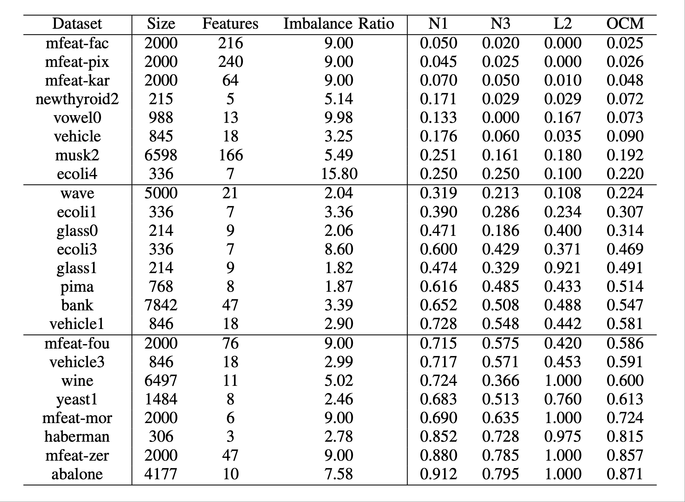

# CBE
A complexity-adaptive boundary-aware ensemble framework for imbalance learning.
- Overall Complexity Measure(OCM)
- Complexity-adaptive Distance-weighted Sampling(CDWS)
- Complexity-adaptive Boundary-aware Ensemble(CBE)

## Method
- Calculate the OCM of datasets; 
- CDWS the majority class instances according to OCM to create balanced subsets; 
- Trains base classifiers on multiple subsets and obtains the ensemble model.

Example of CDWS:

Overview of EnhanceEnsemble:

## Datasets

## Metrics
- F-measure
- G-mean

## Results
First we prove the effectness of OCM.

We compare our method `CBE` with other methods in terms ofG-mean and F-measure on 24 UCI&KEEL datasets.

We also demonstrate the difference of three sample strategies on three categories datasets.

## How to use
### Dependencies
- Python==3.12.7
- numpy==1.26.4
- pandas==2.2.2
- scikit-learn==1.5.1
- imbalanced-learn==0.12.3
- matplotlib==3.9.2

### Scripts
#### Core scripts
- `main.py`: main program. For every dataset, we perform ten times of five-fold cross validation
- `dataloader.py`: load UCI data, directly imported by python or downloaded locally
- `model.py`: define all the compared methods(9 methods)
- `sampler.py`: define the sampling strategy of datasets
- `dwus.py`: distance weighted under-sampling method

#### Auxiliary scripts
- `process_result.py`: post process experiments results that combines two kinds of datasets, find the best α value for `EnhancedEnsemble` and calculate the average values
- `plot_dwus_example.py`: plot the example of DWUS(by `sklearn.datasets.make_classification`)
- `plot_result_figure`: plot the result of ablation study
- `friedman_test.py`: generate the result of Friedman test and Nemenyi test
- `paired_t_test.py`: generate the result of paired t-test
